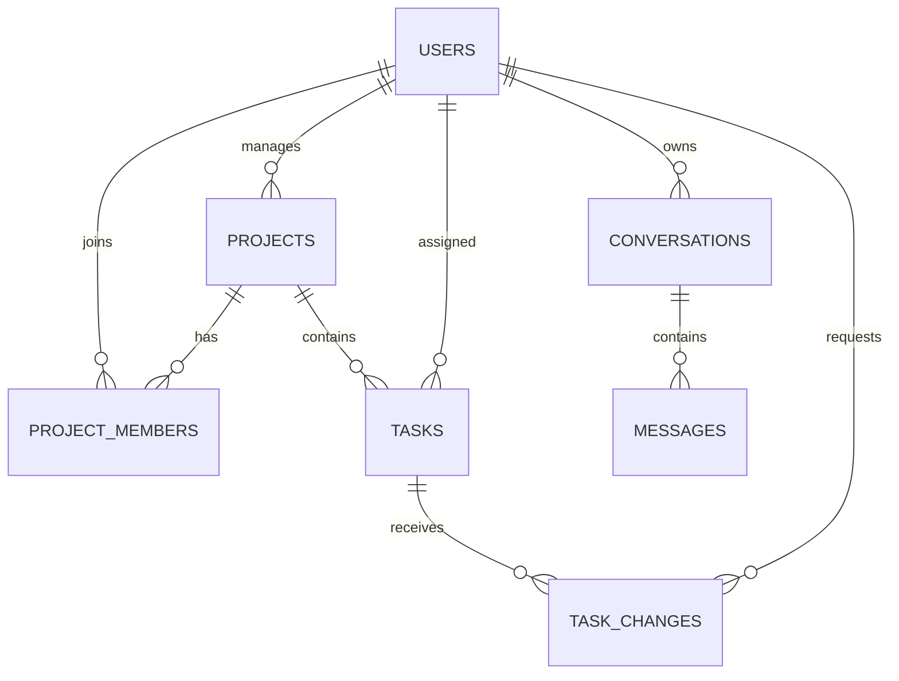

# 4SightAI – Database Design Documentation

## 1. Introduction

The 4SightAI application uses an SQLite relational database to store user accounts, project information, tasks, task-change requests, and AI chat conversations.

The database is designed to support role-based access control and maintain project and task information across application sessions.

## 2. Database Tables

The database contains seven main tables.

### 2.1 Users

Stores user account and login information.

| Column | Description |
|---|---|
| id | Primary key |
| name | User's name |
| email | Unique email address |
| password | Hashed password |
| role | User role (admin, manager, user) |

### 2.2 Projects

Stores project details.

| Column | Description |
|---|---|
| id | Primary key |
| name | Project name |
| description | Project description |
| manager_id | Foreign key referencing users.id |

### 2.3 Project Members

Connects users with the projects they can access.

| Column | Description |
|---|---|
| id | Primary key |
| user_id | Foreign key referencing users.id |
| project_id | Foreign key referencing projects.id |

This table supports many-to-many relationships between users and projects.

### 2.4 Tasks

Stores tasks associated with projects.

| Column | Description |
|---|---|
| id | Primary key |
| title | Task title |
| description | Task description |
| status | Current task status |
| due_date | Task deadline |
| project_id | Foreign key referencing projects.id |
| assignee_id | Foreign key referencing users.id |

### 2.5 Task Changes

Stores AI-proposed task status changes and their approval status.

| Column | Description |
|---|---|
| id | Primary key |
| task_id | Foreign key referencing tasks.id |
| proposed_status | Suggested task status |
| requested_by | Foreign key referencing users.id |
| status | Request status (Pending, Confirmed, Cancelled) |
| created_at | Request creation timestamp |

### 2.6 Conversations

Stores individual AI chat conversations belonging to users.

| Column | Description |
|---|---|
| id | Primary key |
| user_id | Foreign key referencing users.id |
| title | Conversation title |
| created_at | Conversation creation timestamp |

### 2.7 Messages

Stores messages exchanged within conversations.

| Column | Description |
|---|---|
| id | Primary key |
| conversation_id | Foreign key referencing conversations.id |
| role | Message role (user or assistant) |
| content | Message content |
| created_at | Message creation timestamp |

## 3. Entity Relationship Diagram

The following diagram illustrates the relationships between the database tables.

## 4. Database Relationships

- One user can manage multiple projects.
- Users can belong to multiple projects through the Project Members table.
- One project can contain multiple tasks.
- One user can be assigned multiple tasks.
- One task can have multiple task-change requests.
- One user can create multiple AI conversations.
- One conversation can contain multiple messages.

## 5. Role-Based Access

The application supports three roles:

- **Admin:** Can access all projects and tasks.
- **Project Manager:** Can access projects they manage and create or edit tasks within those projects.
- **Regular User:** Can access projects they belong to and change the status of tasks assigned to them.

Access permissions are enforced by the backend.

## 6. Data Security and Integrity

- User passwords are stored as bcrypt hashes rather than plain text.
- Email addresses are unique.
- Foreign keys maintain relationships between tables.
- Database indexes support efficient queries.
- Backend authorization checks prevent unauthorized access to projects and tasks.

## 7. Conclusion

The database design provides persistent storage for users, projects, tasks, AI-proposed changes, and conversations. It supports role-based permissions and allows the AI assistant to use project and task information while respecting user access restrictions.